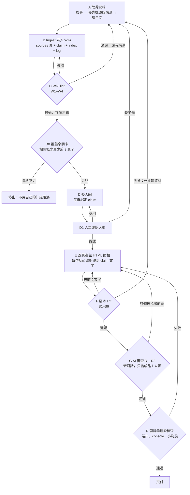

**標題：** 靜宜 411416616 資工2A 簡嘉陞 RAG（檢索增強生成）

---

## 1. LLM Wiki 主題與簡短介紹

**主題：RAG（Retrieval-Augmented Generation，檢索增強生成）。**

這個 Wiki 整理「RAG 是什麼、怎麼運作、怎麼找得準、怎麼進階、有什麼風險」。選 RAG 是因為它本身就是「先找資料、再生成」，和這次作業要練習的 loop 結構相同。

- 6 篇來源（原始論文與官方實驗報告 4 篇、產業科普 1 篇、實作教學 1 篇）
- 10 個概念頁、60 條編號主張（claim）。每條主張都標註來源 `[S#]`，簡報每頁再指回主張編號。

## 2. LLM Wiki 成果

**第 52 頁要求的四項繳交物，對照如下：**
1. 需求摘要：`requirements-summary.md`（第 2 節訪談的摘要，標明為事後補做）
2. AGENTS.md：`AGENTS.md`（依 SCHEMA.md 與訪談整理，標明為 Wiki 建好後補做）
3. 一張 workflow 流程圖：`workflow-flowchart.png`
4. 一次實際執行的檢查報告：`check-report.md`


成果在附件 `rag-wiki.zip`（Markdown 檔案，可直接放 GitHub）：

```
rag-wiki/
├─ SCHEMA.md      規格：設計決策與理由、命名、ingest 流程、檢查規則
├─ index.md       索引（來源表、概念表、已知缺口）
├─ log.md         操作紀錄（含發現的問題）
├─ sources/       S1–S6 各一頁（含讀取深度與限制）
└─ concepts/      10 個概念頁（每條 claim：Cxx：內容 [S#]）
records/          lint、渲染檢查、AI 審查的紀錄
tools/            lint.py、render_check.py
```

**Ingest 的 6 篇來源**

| ID | 來源 | 類型 | 讀取深度 |
|---|---|---|---|
| S1 | Lewis et al. 2020，RAG 原始論文（NeurIPS） | primary | 摘要＋引言 |
| S2 | Gao et al. 2023，RAG 綜述 | primary | 摘要＋引言 |
| S3 | Anthropic，Introducing Contextual Retrieval | primary | 全文 |
| S4 | Palo Alto Networks，RAG 概覽 | secondary | 全文 |
| S5 | Singh et al.，Agentic RAG 綜述 | primary | 約 86% |
| S6 | DEV Community，RAG Pipeline 深入解析 | tutorial | 全文 |

### 「先討論、後生成」

`SCHEMA.md` 第 2 節有 7 項設計決策（例如「Wiki 最小單位是帶編號的 claim」「數字只採原始來源」「比喻必須標示非來源」），都是在 ingest 之前定下的。

> 這 7 項決策是 AI 提出建議並寫下理由，不是 ingest 前我和 AI 的對話紀錄。為了補上「先討論」，我在 ingest 完成後做了下面這份設計訪談。

**訪談日期：2026 年 11 月 23 日**

**訪談說明：** 本次訪談為 ingest 完成後補做的設計訪談，目的是補充說明 LLM Wiki 在規劃時應考量的設計需求與決策。本紀錄並非 ingest 前實際發生的 AI 對話，不應視為當時已完成的討論。

| 題目 | 我的回答 |
|---|---|
| 1. 讀者是誰？ | 主要讀者是修習大型語言模型（LLM）相關課程的學生，以及對 RAG 技術有興趣的初學者。因此內容需要兼顧技術正確性與易讀性。 |
| 2. 要哪些頁面類型？ | 分為來源頁（Sources）、概念頁（Concepts）、索引頁（Index）、規格頁（Schema）及操作紀錄（Log），讓資料來源、技術概念與製作過程都能被追蹤。 |
| 3. 用什麼語言？ | 以繁體中文為主，保留必要的英文技術名詞，例如 Retrieval-Augmented Generation、Embedding、Chunking、Reranking 等，方便讀者查詢與學習。 |
| 4. 出處要多細？ | 每一項重要主張（Claim）都必須標註來源編號，例如 [S1]、[S2]。涉及實驗數字時，必須能回到原始來源核對，不使用未經確認的二手數據。 |
| 5. 來源互相矛盾怎麼辦？ | 優先查閱原始論文或官方文件，確認不同來源的實驗設定與數據。如果無法確認，應記錄差異及不確定性，而不是自行選擇一個數字。 |
| 6. 一次一篇還是批次？ | 採用逐篇 ingest 的方式。每讀取一篇來源，就整理來源資訊、擷取 Claim、更新概念頁及索引，並執行 lint 檢查，降低批次處理造成的錯誤累積。 |
| 7. 之後要產出什麼？ | 以 Wiki 作為知識基礎，進一步製作 18 頁 HTML 教學簡報，內容包含 RAG 原理、檢索流程、進階技術、風險及小測驗，且每頁都能追溯到對應的 Claim。 |
| 8. lint 要檢查什麼？ | 檢查 Claim 編號是否重複、是否具有來源、來源宣稱的 Claim 是否存在、索引計數是否正確，以及簡報引用的 Claim、數字和參考網址是否正確。 |

**訪談答案與實際執行的對照（誠實紀錄）**
- 第 4、5 題：實際做法一致。Contextual Retrieval 的數字出現矛盾時，改讀 Anthropic 原文確認（log L-04）。
- 第 6 題：訪談的理想是「每篇 ingest 後就跑 lint」，但**這次實際是 6 篇都收完後才第一次跑 lint**（log L-11），所以 index 的計數錯誤拖到那時才被發現。流程圖的 C 節點是設計目標，下次執行應落實為逐篇檢查。
- 第 7、8 題：與實際成果一致（18 頁、lint 項目相符）。

## 3. 教學 HTML 簡報

- **簡報：** 附件 `rag-teaching-slides.html`，單一檔案，用瀏覽器直接開啟即可瀏覽，不需要網路或登入。
  （若之後上傳到 GitHub Pages，網址：〔待補〕）
- 操作：← → 或空白鍵翻頁、F 全螢幕、可用 `#5` 這類網址直接跳頁。

**教學結構（18 頁）**：學習路線 → 問題（為什麼會答錯）→ 定義（含比喻）→ 兩階段流程 → 切塊 → 嵌入與向量搜尋 → 混合搜尋與重排序 → 情境化檢索 → 成效圖表 → 與微調／提示工程比較 → 演進 → 取捨 → 風險 → 回顧 → 小測驗（3 題，可點選）→ 製作流程 → 參考來源。

**Wiki 與簡報的對應**：每頁底部（灰色小字）由腳本自動顯示「對應的 concept 頁＋主張編號」。簡報使用了 60 條主張中的 56 條；沒用的 4 條（C15、C16、C21、C25）是細節。

## 4. loop／graph 設計



**迴圈次數上限：E → F → G → R 最多 3 輪。** 超過 3 輪就停下來交給人，不繼續自動改。

**哪些步驟會重複？**
- A → B → C：設計上每一篇來源各跑一次。**這次實際是 6 篇收完後才跑一次 lint**（見第 2 節訪談對照）。
- E ↔ F ↔ G ↔ R：每一格內部是小圈，只修被指出的頁，不整份重做。
- 大圈（退回 A）應該很少發生。這次一次都沒發生。

**哪些地方要檢查或重新生成？**

| 檢查點 | 誰檢查 | 檢查什麼 | 失敗時回到 |
|---|---|---|---|
| C Wiki lint | 腳本 | claim 有來源、編號不重複、來源頁宣稱的 claim 真的存在、index 計數正確 | B |
| D0 覆蓋率 | 腳本／AI | 相關概念頁是否足夠（少於 3 頁就停） | 停止 |
| D1 人工確認大綱 | 人 | 主題有沒有漏、順序合不合理 | D 或 A |
| F 簡報 lint | 腳本 | 每頁有 `data-claims`、編號存在、**每個數字都能在 wiki 找到**、比喻有標示、參考網址一致 | E 或 A |
| G AI 審查 | 新對話的 AI | R1 每句話忠於所引用的 claim；R2 範圍與限定語沒被省略；R3 來源都用到、沒有講反 | E（只修被指出的頁） |
| R 渲染檢查 | headless Chrome | 內容是否超出一屏、console 錯誤、小測驗互動 | E |

**為什麼這樣設計？**
1. LLM 最容易在「數字」上出錯，所以每個數字都必須能回查到 wiki，檢查才不靠人眼。
2. 腳本只能擋編號和數字，擋不了「語意講過頭」，所以加 AI 審查；而且要開新對話、只給成品和來源，不讓它審自己的作品。
3. AI 審查放在渲染檢查前面：文字先定稿，才不會改完字又要重跑排版。
4. 「lint 通過」不等於「畫面正常」，所以另外加一道真的打開瀏覽器的檢查。
5. 自主性要有邊界（參考 S5 的原則：評估後再修正、要有停止條件）。這裡的停止條件是：全過、改滿 3 輪、資料不足。

**誠實說明這次沒做到的**
- **D1 人工確認大綱：這次執行沒有做**。大綱由 AI 擬定後直接進入產生，這一關是事後補進設計的。你可以現在看一遍 18 頁的順序（見第 3 節），算補做，但請不要把它寫成「當時有做」。
- AI 審查的審查者和產生者是同一個模型家族，只是不同的對話，不是不同模型。

## 5. 一次實際執行的結果與檢查紀錄

完整紀錄在 `rag-wiki/log.md` 與 `records/`（含 `records/ai-review.md`）。

**取得資料（A）**
- 搜尋 5 組關鍵字，挑出 6 篇來源。
- 發現資料衝突：Contextual Retrieval 的數字在搜尋摘錄中出現三種版本。讀 Anthropic 原文後確認：失敗率 5.7% → 3.7%（降低 35%）→ 2.9%（降低 49%）→ 加重排序 1.9%（降低 67%）。第三方頁面的 3.5%／1.9%／1.3% 與原文不符，不採用。
- S5 只讀到 86%、S1／S2 只讀到摘要層級，都已在來源頁註明，且 S1／S2 不收錄任何實驗數字。

**檢查結果**

| 步驟 | 內容 | 結果 |
|---|---|---|
| lint 第 1 次 | Wiki + 簡報 | 2 個錯誤：①index 手寫「56 條」，實際 60（**真錯誤**）；②「BM25」被誤判成數字 25（**檢查器誤報**） |
| 修正 | 修 index、修 lint、補 5 條有教學價值的 claim 進簡報 | — |
| lint 第 2 次 | 同上 | 0 錯誤、0 警告 |
| 負向測試 | 故意把圖表 3.7% 改成 3.5%；把引用的 C83 改成 C99 | 兩者都被 lint 擋下 |
| 渲染檢查 | headless Chrome，逐頁 | 第 10、16 頁超出一屏且小字蓋到內文 → 修正後 18 頁都正常 |
| **AI 審查第 1 輪** | 新對話，逐頁比對簡報與 claim；並用網路搜尋回頭核對 Anthropic 原文數字 | **8 處問題**：7 處語意超出 claim（例如自己補上「便宜」「上下文碎裂」、把 Anthropic 實驗設定寫成通則）、1 處第 17 頁流程順序說錯 |
| 修正 | 逐處改回 claim 原意或加範圍標示 | — |
| 重跑 lint＋渲染 | 同上 | lint 0／0；18 頁無溢出、console 0、小測驗正常 |
| **AI 審查第 2 輪** | 重讀被修改的 10 處 | 通過（共 2 輪，上限 3 輪） |

**這次沒做到的**：C43（150 塊）、C55（1.02 美元）、C56（200,000 token）沒有重新對照原文，仍只信 wiki 紀錄；「RAG vs 微調」只有單一來源。

## 6. 反思

**哪個節點最常出錯？**

| 節點 | 件數 | 內容 |
|---|---|---|
| A 取得資料 | 3 | 數字三種版本互相矛盾；S5 只讀到 86%；S1／S2 只讀到摘要 |
| B 寫入 Wiki | 1 | index 手寫計數錯誤 |
| E 產生簡報 | 11 | 2 頁排版溢出；9 條 claim 沒被用到；缺 hashchange 導覽；**AI 審查抓到 8 處語意問題** |
| 檢查本身（F） | 1 | lint 誤報（BM25 → 25） |

**件數最多的是 E（產生簡報）**，而且其中 7 件是「語意講過頭」，腳本完全看不到。
**但最危險的仍是 A（取得資料）**：矛盾的數字如果直接寫進 wiki，後面所有檢查都會通過，因為簡報和 wiki 是一致的，只是都錯了。E 的錯誤可以被 AI 審查抓到，A 的錯誤要靠回頭讀原文。

**我把檢查往前移到哪裡？**
1. **A／B 階段：「數字只採原始來源」成為 ingest 規則（SCHEMA D3）。** 發現矛盾當下就改讀原文，不等到做簡報才查。
2. **B 後面加 C（Wiki lint）**，讓沒有來源、編號重複、計數不符的錯誤在做簡報前就被擋下。
3. **E 階段：新增 SCHEMA D8，「簡報每一句話都要對得到 claim 的文字，對不到就刪」。** 原本 AI 審查是事後才抓，現在希望在逐頁產生時就不要寫出推論。
4. 每個來源頁寫明「讀取深度」，讀不完整的來源不收錄數字。

**有沒有修改 workflow／graph？為什麼？**
- **加了 G（AI 審查）。** 腳本只能擋編號和數字，AI 審查抓到 8 處腳本看不到的問題。教訓：lint 通過只代表引用和數字沒錯，不代表文字忠於來源。
- **加了 R（渲染檢查）。** lint 通過之後，真瀏覽器逐頁檢查抓到 2 頁排版問題。
- **G 放在 R 前面。** 文字定稿後再檢查排版，避免改字又重跑。
- **加了停止條件：最多 3 輪、資料不足就停（D0）。** 沒有停止條件的 loop，出錯時會一直轉。
- **加了 D1 人工確認大綱**（這次沒執行，見第 4 節）。
- **修了 F 本身。** lint 也會誤報，所以做負向測試：故意塞錯誤，確認它真的會擋。
- **index 的計數改由 lint 驗證，不再手寫。** 人工數數是這次唯一純粹的人為錯誤。
- **F 失敗時多一條路回到 A。** 簡報需要的資料 wiki 沒有，不能在簡報裡自己補。
